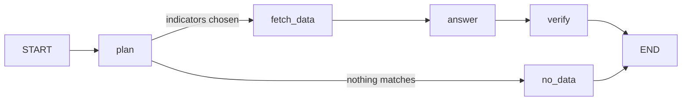

# macro-intelligence

AI-powered macroeconomic research assistant built with Python, LangGraph, and OpenRouter, integrating economic indicators from central banks and international data providers.

Ask a question in plain language. The agent picks the indicators it needs, fetches them from official sources, computes the statistics with pandas, and has the LLM explain the result using only that data, with sources cited. It runs on free OpenRouter models by default.

## Quick start

Requires [uv](https://docs.astral.sh/uv/) and an [OpenRouter API key](https://openrouter.ai/keys).

```bash
uv sync
cp .env.example .env              # then add your OPENROUTER_API_KEY
uv run macro-intelligence-app     # chat app in the browser
```

Or from the terminal:

```bash
uv run macro-intelligence "How has Brazil's 12-month inflation and the Selic rate changed over the last 2 years?"
```

## Chat app

The app uses [shinychat](https://posit-dev.github.io/shinychat/py/) (`page_chat`). Each reply shows which data is being looked up, streams the answer, and ends with its sources and the model that wrote it. Follow-up questions work ("and Argentina?"): the last few messages go to the model with each question.

For development, with auto-reload:

```bash
uv run shiny run src/macro_intelligence/app.py --reload
```

## How it works



| Node | What it does | Uses the LLM? |
| --- | --- | --- |
| `plan` | Picks indicators, countries and time window from a fixed catalog (structured output) | Yes |
| `fetch_data` | Calls python-bcb and the World Bank API; one failing source doesn't stop the others | No |
| `answer` | Computes stats with pandas, then the LLM writes the answer from that data only | Yes |
| `verify` | Checks every figure in the answer against the fetched data (see [Data check](#data-check)) | No |
| `no_data` | Lists available data when the question can't be answered | No |

The LLM can only choose indicators from the catalog in `src/macro_intelligence/indicators.py`, so it never invents series codes.

## Data check

Each answer ends with a line saying whether its figures come from the fetched data:

```text
✓ Data check: all 18 figures match the fetched data (3 calculated from it).
⚠ Data check: 1 of 12 figures aren't in the fetched data, so check them: 6.1
```

The `verify` node (`grounding.py`) is plain Python, no LLM. It finds every number in the answer and looks it up among the values the model was given, at the precision it was written (4.58 matches 4.5813) and ignoring sign ("fell 0.29 p.p." matches a change of -0.29). It also accepts:

- dates, years in the period, series codes and numbers from the question (a figure with `%` must match an actual value);
- a difference or percent change between two data values the answer also quotes ("from 5.23 to 5.50, up 0.27"), counted as calculated.

Anything else is listed, so a figure from the model's memory or a wrong calculation is visible. Bare integers below 10 ("2 years") aren't checked unless followed by `%`. The check can't tell whether a correct figure is described correctly (e.g. the wrong month); for that, read the sources.

| Module | Role |
| --- | --- |
| `graph.py` | LangGraph workflow and prompts |
| `indicators.py` | Indicator catalog |
| `sources.py` | Data fetchers (BCB, World Bank) |
| `analysis.py` | Statistics with pandas, source citations |
| `grounding.py` | Data check of each answer's figures |
| `tracing.py` | Optional Phoenix tracing |
| `models.py` | Free model selection |
| `llm.py` | OpenRouter client with fallbacks |
| `stream.py` | Graph progress as Markdown chunks for the chat |
| `app.py` | shinychat app |
| `cli.py` | Command line interface |

## Models

With no model set, the agent picks free OpenRouter models the same way [shinychat-openrouter](https://github.com/TiagoAdriaNunes/shinychat-openrouter) does:

1. Free text models (zero prompt and completion price) that support tool calling.
2. Only models your account can use with its [privacy settings](https://openrouter.ai/settings/privacy), and whose provider answered every request in the last 30 minutes.
3. Ranked by Artificial Analysis intelligence index, then newest first; often rate-limited models last.

The top 3 are chained as fallbacks, ending with OpenRouter's `openrouter/free` router: if a model fails, is rate limited, or replies without a plan or an answer, the next one takes over. Reasoning models run at low effort. The app rebuilds the list every hour.

To use one specific model, set `OPENROUTER_MODEL` in `.env` or pass `--model`. Lists of excluded and low-priority models are at the top of `models.py`.

## Data available

| Key | Indicator | Source | Frequency |
| --- | --- | --- | --- |
| `br_ipca_monthly` | IPCA inflation, monthly change | BCB SGS 433 | monthly |
| `br_ipca_12m` | IPCA inflation, 12-month | BCB SGS 13522 | monthly |
| `br_selic_target` | Selic target rate | BCB SGS 432 | daily |
| `br_usd_brl` | USD/BRL exchange rate | BCB SGS 1 | daily |
| `br_unemployment` | Unemployment rate (PNAD Continua) | BCB SGS 24369 | monthly |
| `wb_gdp_growth` | Real GDP growth, any country | World Bank `NY.GDP.MKTP.KD.ZG` | annual |
| `wb_inflation` | CPI inflation, any country | World Bank `FP.CPI.TOTL.ZG` | annual |
| `wb_unemployment` | Unemployment rate, any country | World Bank `SL.UEM.TOTL.ZS` | annual |

Daily series are reduced to the last value of each month before they reach the LLM. Neither source needs an API key. The World Bank API sometimes takes about a minute to respond.

## Command line

```bash
uv run macro-intelligence "What is the current Selic rate and how has it changed this year?"
uv run macro-intelligence -v "Compare GDP growth in Brazil, Argentina and Chile"   # show models and plan
uv run macro-intelligence --model openai/gpt-4o-mini "Is Brazilian unemployment falling?"
```

From Python:

```python
from macro_intelligence.graph import build_graph
from macro_intelligence.llm import make_llm

graph = build_graph(make_llm())
result = graph.invoke({"question": "How has USD/BRL moved in the last 2 years?"})
print(result["answer"])
```

## Tracing

To see what happens inside each question (every graph node, prompt, model call, fallback and timing), use [Arize Phoenix](https://arize.com/docs/phoenix). It's free and open source, and runs on your machine; traces stay local.

1. Start Phoenix (UI at http://localhost:6006):

   ```bash
   uv run python -m macro_intelligence.tracing
   ```

   This starts Phoenix with its UI telemetry and internet downloads turned off.

2. Add `PHOENIX_TRACING=true` to `.env`.
3. Ask questions in the app or CLI, then open the `macro-intelligence` project in Phoenix.

Each question is one trace: `plan` (the model call and the parsed plan), `route_after_plan`, `fetch_data`, and `answer` (the prompt with the data, and the reply). Phoenix and its LangChain instrumentation are dev dependencies; tracing stays off when `PHOENIX_TRACING` isn't set. Remove the setting when Phoenix isn't running, or the app logs export errors.

The graph's structure as a Mermaid diagram:

```python
print(build_graph(llm).get_graph().draw_mermaid())
```

## Tests

```bash
uv run pytest
```

Tests use a fake LLM, fake data and a fake model catalogue, so they run offline without an API key.

## Formatting and linting

[Ruff](https://docs.astral.sh/ruff/) formats and lints the code (settings in `pyproject.toml`):

```bash
uv run ruff format          # format
uv run ruff check --fix     # lint, fixing what it can
```

In VS Code, the Ruff extension (`charliermarsh.ruff`) can format on save.

## Adding an indicator

Add an `Indicator` entry to `CATALOG` in `src/macro_intelligence/indicators.py`. The planner prompt lists the catalog automatically. For a new data source, add a fetcher in `sources.py` that returns the same dataset shape.

## Roadmap

- [ ] Model dropdown in the app, as in shinychat-openrouter
- [ ] DBnomics source (IMF, OECD, Eurostat and other providers)
- [ ] IBGE data via sidrapy
- [ ] Charts in answers
- [ ] Caching for data requests

## License

MIT
