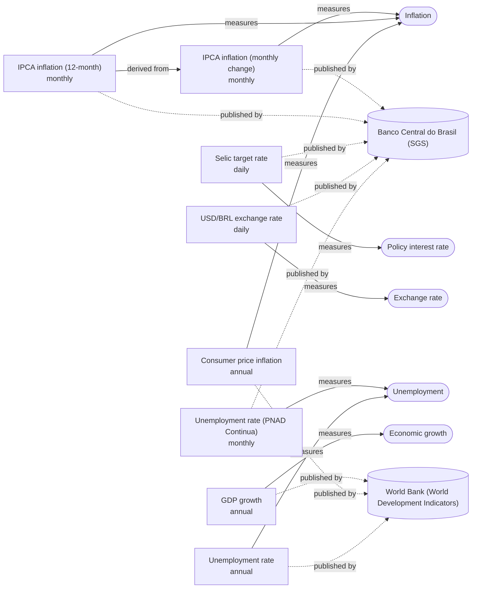

<!-- Generated by `uv run python -m macro_intelligence.contracts`; don't edit by hand. -->
# Ontology

Each indicator measures a concept and is published by a source; some are derived from another indicator. Indicators of the same concept are related but not always comparable (e.g. monthly vs. annual inflation).

| Concept | Definition |
| --- | --- |
| Inflation | The rise in consumer prices over time. |
| Policy interest rate | The interest rate a central bank sets to steer inflation and activity. |
| Exchange rate | The price of one currency in terms of another. |
| Unemployment | The share of the labor force without a job and looking for one. |
| Economic growth | The change in the volume of goods and services an economy produces (real GDP). |
